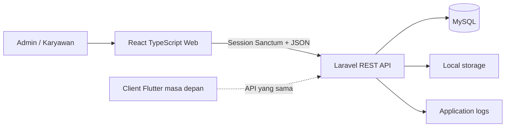
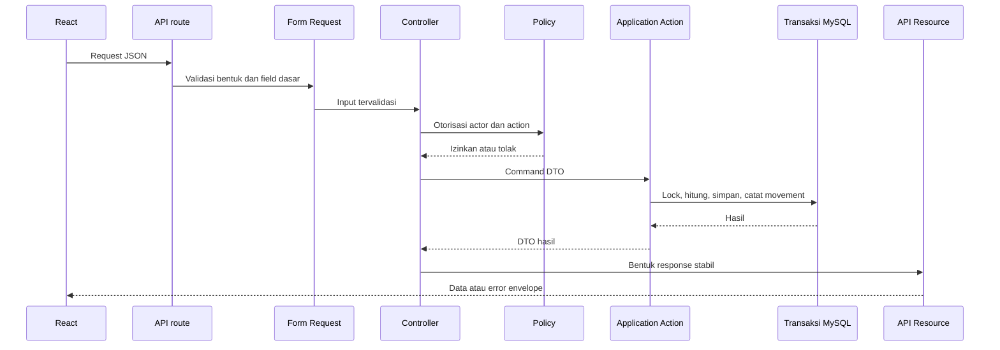

# Arsitektur Aplikasi

## CINNAMON Inventory dan Sales Management

**Status:** Baseline implementasi revisi  
**Sumber kebenaran:** `PRD.md` dan `Design.md`  
**Gaya arsitektur:** modular monolith dengan batas aplikasi yang jelas  
**Cakupan MVP:** satu toko, role Admin dan Karyawan, Laravel API, client web React

## 1. Tujuan arsitektur

- Menempatkan aturan FIFO, approval, stok, HPP, profit, dan koreksi di backend yang mudah diuji.
- Memisahkan transport HTTP, otorisasi, use case aplikasi, aturan domain, dan persistence secara mudah dipahami.
- Memulai dari satu deployment Laravel dan satu database MySQL.
- Memungkinkan React dan client Flutter di masa depan memakai kontrak API yang sama.
- Mendahulukan fitur bawaan Laravel sebelum menambah package.
- Mengikuti alur bisnis TA dan README tanpa menambahkan infrastruktur yang belum dibutuhkan toko.

### 1.1 Cara membaca README awal

README awal menjelaskan implementasi Laravel 12 + Blade/Vite dan alur instalasi lokal sebelumnya. Revisi ini mempertahankan aturan bisnis serta maksud setup tersebut, tetapi target yang disepakati menjadi Laravel 13 sebagai API dan React TypeScript sebagai client web. Blade adalah referensi legacy, bukan frontend kedua yang dipelihara. Node/npm hanya digunakan untuk tooling frontend.

## 2. Stack yang direkomendasikan

| Lapisan | Pilihan | Alasan |
|---|---|---|
| Backend | Laravel 13, PHP 8.5 | API REST, validasi, transaksi, policy, migration, queue, dan testing |
| Autentikasi | Laravel Sanctum | Cookie session untuk React SPA; opsi token untuk mobile di masa depan |
| Frontend | React, TypeScript, Vite | UI terpisah, reusable, dan kontrak type-safe |
| State client | TanStack Query | Cache server, invalidation, loading, retry, dan mutation state |
| HTTP client | Axios atau wrapper fetch kecil | Base URL, credentials, dan normalisasi error terpusat |
| Form/schema | React Hook Form dan Zod | State form dan umpan balik bentuk data; Laravel tetap otoritatif |
| Database | MySQL 8+ / MariaDB kompatibel | Sesuai TA; mendukung transaksi, foreign key, dan decimal |
| Styling | CSS variables dengan token terdata; Tailwind opsional | Menjaga sistem visual konsisten tanpa menyembunyikan keputusan layout |
| Testing backend | Pest atau PHPUnit dan HTTP test Laravel | Menguji boundary API serta aturan FIFO/HPP |
| Testing frontend | Vitest dan Testing Library | Menguji perilaku pengguna dan state transition |
| Formatting | Laravel Pint, ESLint, Prettier | Quality check yang konsisten |
| Deployment | Satu application service dan managed MySQL atau VPS kecil | Sederhana untuk MVP portfolio |

Frontend target bukan Laravel Blade. Laravel menyajikan API dan React memiliki UI web. Blade hanya boleh tersisa untuk halaman fallback yang dihasilkan framework.

## 3. Konteks sistem



Tidak ada backend Node/Express pada proyek ini. Node dan npm hanya membangun serta menguji client React.

## 4. Batas modul backend

MVP tetap satu aplikasi. Modul berbagi database, tetapi berkomunikasi melalui application service dan model yang jelas, bukan melalui pemanggilan controller lain.

- **Identity:** user, role, login, profil, policy.
- **Catalog:** kategori, satuan, produk, status produk, gambar.
- **Parties:** supplier dan customer opsional.
- **Receiving:** dokumen barang masuk, detail, verifikasi, approval, stok pending.
- **Inventory:** proyeksi stok, batch periode, movement immutable, koreksi.
- **Sales:** barang keluar, detail, alokasi batch FIFO, HPP, gross profit.
- **Reporting:** query baca untuk stok, barang masuk, barang keluar, HPP, profit, dan ledger.
- **Ledger:** catatan debit/kredit internal yang dihasilkan dokumen operasional.
- **Audit:** actor, action, request id, dan snapshot sebelum/sesudah yang aman.

Multiwarehouse, transfer, payment gateway, akuntansi penuh, dan notifikasi berada di batas masa depan, bukan dependency MVP.

## 5. Alur request sampai database



Approval penerimaan, posting penjualan, dan koreksi stok masing-masing memiliki satu batas transaksi. FIFO dan HPP dihitung di server ketika baris produk/batch terkait dikunci.

## 6. Tanggung jawab clean architecture

### Route

Memetakan endpoint `/api/v1` ke controller dan middleware. Route tidak berisi perhitungan bisnis.

### Form Request

Memeriksa field wajib, tipe, rentang, format, dan referensi dasar. Aturan yang bergantung pada stok atau status dokumen ditangani oleh application action.

### Controller

Menerjemahkan HTTP input menjadi command/query, menjalankan otorisasi, memanggil action/query, lalu mengembalikan Resource atau error standar. Controller tidak menghitung total dan tidak mengubah stok secara langsung.

### Action atau Service

Mewakili use case seperti `ApproveIncomingReceipt`, `PostSale`, `AdjustStock`, atau `BuildProfitReport`. Komponen ini memiliki batas transaksi, orkestrasi aturan domain, dan side effect.

### Aturan domain dan value object

Perhitungan FIFO, HPP, transisi status, validasi desimal, dan profit dibuat terisolasi serta dapat diuji. Class PHP biasa sudah cukup; domain package tidak diperlukan.

### Model

Mendefinisikan atribut, cast, relasi, scope, dan constraint persistence yang wajar untuk Eloquent. Model tidak mengorkestrasi seluruh workflow bisnis.

### Policy

Memeriksa izin Admin/Karyawan untuk setiap action. API tetap menjadi sumber kebenaran meski React menyembunyikan menu. Sesuai TA, Admin memiliki akses penuh; Karyawan hanya mencatat barang masuk dan mengelola produk pending/not-ready.

### Query

Memiliki filter baca, sorting, eager loading, dan agregasi laporan yang kompleks. Repository hanya ditambahkan bila mewakili batas persistence nyata; wrapper generik untuk setiap method Eloquent tidak diperlukan.

### Resource dan DTO

Resource menyerialisasikan bentuk API yang stabil tanpa membocorkan password, kolom internal, atau field yang tidak disetujui. DTO memperjelas input command dan output action.

## 7. Struktur folder

### Backend Laravel

```text
backend/
  app/
    Actions/
      Auth/
      Receiving/
      Inventory/
      Sales/
      Reports/
    Domain/
      Inventory/
        FifoAllocator.php
        HppCalculator.php
        StockRules.php
    Enums/
    Http/
      Controllers/Api/V1/
      Requests/
      Resources/
      Middleware/
    Models/
    Policies/
    Queries/
    Services/
    Support/
  database/
    factories/
    migrations/
    seeders/
  routes/
    api.php
    web.php
  bootstrap/
  config/
  tests/
    Feature/
    Unit/
    TestCase.php
```

Kode produksi hanya di `app/`, `routes/`, `config/`, `database/`, dan `bootstrap/`. Kode test hanya di `tests/`. Kode produksi tidak ditulis di `tests/`, dan kode test tidak ditulis di `app/`.

### Client React

```text
frontend/
  src/
    app/
      router/
      providers/
      permissions/
    features/
      auth/
      catalog/
      receiving/
      inventory/
      sales/
      reports/
    components/
      ui/
      layout/
      feedback/
    lib/
      api/
      formatters/
      validators/
    types/
    assets/
```

Folder Express lama seperti `server.js`, migration Sequelize, dan model Sequelize bukan bagian dari backend Laravel. React boleh memiliki folder `api` atau `services`, tetapi tidak boleh menyalin aturan FIFO/HPP backend.

## 8. Autentikasi dan otorisasi

- React memakai cookie Sanctum dan perlindungan CSRF pada domain lokal/staging yang dikonfigurasi.
- Endpoint login, logout, dan profil adalah API; hash password dikelola Laravel.
- Admin dan Karyawan adalah satu-satunya role MVP.
- Policy Admin melindungi master data, penjualan, approval penerimaan, koreksi stok, ledger, laporan, dan manajemen user.
- Policy Karyawan mengizinkan pencatatan penerimaan dan perubahan produk pending/not-ready. Karyawan tidak dapat mem-posting penjualan, menyetujui penerimaan, mengoreksi stok tersimpan, atau mengelola user.
- Client Flutter masa depan dapat memakai token Sanctum yang dapat dicabut; pembangunannya tidak wajib untuk MVP web.
- `401` berarti belum terautentikasi; `403` berarti sudah login tetapi tidak berwenang.

## 9. Arsitektur API

- Prefix: `/api/v1`.
- Envelope JSON dan error ditentukan pada `API.md`.
- API Resource menjadi batas serialisasi.
- Command mutasi menerima idempotency key bila retry berpotensi menggandakan dampak stok.
- String tanggal mengikuti ISO 8601; timestamp disimpan UTC jika memungkinkan dan ditampilkan Asia/Jakarta.
- Nilai uang dan quantity decimal diserialisasikan sebagai string untuk menghindari error floating point JavaScript.
- Total dari client hanya petunjuk; total server adalah sumber kebenaran.

## 10. Interaksi database

- Approval receipt, sale, dan adjustment menggunakan transaksi.
- FIFO membaca batch eligible tertua dan mengunci baris terkait sebelum mengurangi saldo.
- `stock_movements` append-only; koreksi membuat movement baru, bukan mengedit histori.
- Total ready/pending produk adalah proyeksi yang diubah dalam transaksi yang sama dengan sumbernya.
- Foreign key, unique index, dan check rule menegakkan hal yang dapat ditegakkan MySQL; policy menegakkan actor permission.
- Query laporan memiliki filter, pagination, dan eager loading yang jelas. Index harus didukung kebutuhan query nyata.

## 11. Konfigurasi environment

Backend membutuhkan `APP_ENV`, `APP_KEY`, `APP_URL`, `APP_DEBUG`, `DB_*`, domain stateful Sanctum, session/cookie, `QUEUE_CONNECTION`, `CACHE_STORE`, dan storage. React hanya menerima `VITE_API_URL` serta feature flag non-rahasia. `.env` tidak boleh masuk commit.

Local default dapat menggunakan MySQL dari XAMPP pada `127.0.0.1:3306` dan password root kosong, tetapi credential sebenarnya tetap berada di konfigurasi lokal.

## 12. Error handling dan observability

- Normalisasi error validasi, otorisasi, conflict, rate limit, dan error tak terduga.
- Gunakan error code stabil seperti `INSUFFICIENT_STOCK`, `RECEIPT_ALREADY_APPROVED`, dan `DOCUMENT_ALREADY_POSTED`.
- Tambahkan request id pada response dan structured log.
- Jangan membocorkan stack trace, SQL, password, token, atau data pembayaran pada production.
- Catat approval, posting, koreksi, login gagal, dan pengelolaan user dengan actor context.

## 13. Layanan eksternal dan AI

MVP tidak membutuhkan layanan eksternal. Local storage cukup untuk gambar produk dan export development. S3, email/WhatsApp, queued export, barcode scanning, dan Flutter menjadi tambahan masa depan di balik integrasi eksplisit.

AI bukan bagian dari core inventory. Jika kelak dipakai untuk ringkasan laporan atau pencarian, AI hanya boleh membaca data yang telah diotorisasi; AI tidak boleh mem-posting transaksi, mengubah stok, atau mengubah permission.

## 14. Strategi testing

1. Unit test untuk FIFO, HPP, profit, quantity, dan transisi status.
2. Feature test untuk login, policy, validasi, approval receipt, posting sale, koreksi, dan laporan.
3. Transaction test untuk stok tidak cukup, duplicate posting, rollback, dan perubahan stok bersamaan.
4. React test untuk form, loading/empty/error state, visibility berbasis permission, dan journey utama.
5. Build dan lint check pada CI.

## 15. Strategi deployment

- Lokal: PHP 8.5, Composer, MySQL/XAMPP, Node.js, npm, serta server Laravel/React.
- Staging: database bersih, seed sintetis, HTTPS, dan release build.
- Demo/production: satu service Laravel, managed MySQL, persistent storage, log, dan backup.
- Urutan release: CI check, backup bila perlu, migration backward-compatible, deploy backend/frontend, smoke check, lalu monitoring.

## 16. Kriteria penerimaan arsitektur

- Backend dapat dijalankan sebagai Laravel tanpa Node/Express atau Sequelize.
- React berkomunikasi melalui API terdokumentasi dan tidak mengulang aturan FIFO/HPP.
- Reviewer dapat menemukan setiap use case pengubah stok, policy, migration, dan test.
- MVP dapat di-deploy sebagai satu aplikasi dan satu database tanpa queue, event bus, microservice, atau integrasi cloud wajib.
- Fitur masa depan memiliki extension point yang jelas tanpa menambah dependency ke release pertama.

