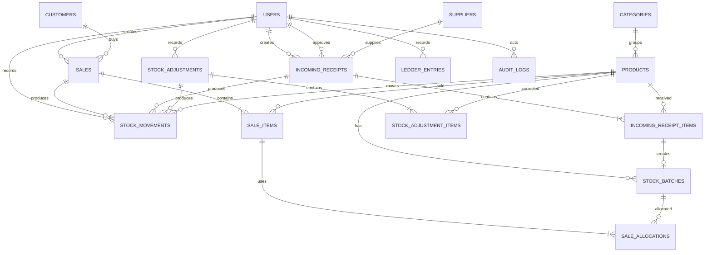

# Database Design

## CINNAMON Inventory and Sales Management

**Status:** Revised MVP baseline  
**Database:** MySQL 8+ / compatible MariaDB with InnoDB  
**Sources of truth:** `PRD.md` and `Architecture.md`  
**Scope:** one store, two roles, spice inventory, FIFO, HPP, profit, and simple ledger

## 1. Design principles

- Keep the schema close to the TA: products, categories, suppliers, incoming goods, outgoing goods, stock history, and simple ledger.
- Store quantities as `DECIMAL(15,3)` and money as `DECIMAL(15,2)`.
- Keep posted transaction facts immutable. Corrections create new records.
- Store the HPP allocation used by a sale so future purchase prices cannot change historical profit.
- Use a transaction for every operation that changes stock or ledger values.
- Deactivate referenced master data instead of deleting it.
- Do not add multi-warehouse tables, payment gateway tables, or full accounting tables to the MVP.

## 2. Ownership and authorization

The MVP has one store context, so no `warehouse_id` is required in the first schema. Authorization is based on the authenticated user role and the action policy:

- Admin may manage all master data, approve receipts, post sales, correct stock, view reports, and manage users.
- Karyawan may record incoming goods and perform the operational actions explicitly allowed by policy.
- Database ownership is represented by `created_by`, `approved_by`, `posted_by`, and `recorded_by` where the action is sensitive.
- MySQL does not provide application row-level security for this design. Laravel policies and scoped queries are the authorization boundary.

## 3. Entity relationship diagram

## 4. Tables and columns

### Identity

#### `users`

`id` BIGINT primary key, `name` VARCHAR(120), `email` VARCHAR(160) unique, `password` VARCHAR(255), `role` ENUM(`admin`,`karyawan`), `is_active` BOOLEAN default true, `last_login_at` DATETIME nullable, timestamps, and soft delete only if the final authorization design needs it. Laravel's password reset fields may be retained.

### Catalog and parties

#### `categories`

`id`, `name` VARCHAR(100), `slug` VARCHAR(120) unique, `description` TEXT nullable, `is_active` BOOLEAN, timestamps.

#### `products`

`id`, `category_id` FK, `sku` VARCHAR(80) unique, `name` VARCHAR(180), `unit` VARCHAR(30), `purchase_price` DECIMAL(15,2) nullable reference cost, `selling_price` DECIMAL(15,2), `ready_stock` DECIMAL(15,3) default 0, `pending_stock` DECIMAL(15,3) default 0, `minimum_stock` DECIMAL(15,3) default 0, `image_path` VARCHAR(255) nullable, `is_active` BOOLEAN, timestamps.

`ready_stock` and `pending_stock` are operational projections for fast dashboard reads. They must be changed only inside the same transaction that writes the source receipt, sale, or adjustment.

#### `suppliers`

`id`, `name` VARCHAR(160), `address` TEXT nullable, `contact` VARCHAR(80) nullable, `email` VARCHAR(160) nullable, `is_active` BOOLEAN, timestamps.

#### `customers`

`id`, `name` VARCHAR(160), `address` TEXT nullable, `contact` VARCHAR(80) nullable, `email` VARCHAR(160) nullable, `is_active` BOOLEAN, timestamps. A sale may have no customer in the MVP.

### Receiving and batches

#### `incoming_receipts`

`id`, `receipt_number` VARCHAR(40) unique, `supplier_id` FK, `receipt_date` DATE, `status` ENUM(`draft`,`pending`,`approved`,`cancelled`), `total_weight` DECIMAL(15,3), `total_cost` DECIMAL(15,2), `notes` TEXT nullable, `created_by` FK users, `approved_by` FK users nullable, `approved_at` DATETIME nullable, timestamps.

#### `incoming_receipt_items`

`id`, `incoming_receipt_id` FK, `product_id` FK, `weight_initial` DECIMAL(15,3), `weight_final` DECIMAL(15,3) nullable, `unit_cost` DECIMAL(15,2), `subtotal` DECIMAL(15,2), `status` ENUM(`pending`,`approved`,`rejected`), `verification_note` TEXT nullable, timestamps.

The server recalculates `subtotal` and the receipt totals. Client-provided totals are not authoritative.

#### `stock_batches`

`id`, `product_id` FK, `incoming_receipt_item_id` FK unique nullable, `batch_code` VARCHAR(50), `period_start` DATE, `period_end` DATE, `received_at` DATE, `quantity_received` DECIMAL(15,3), `quantity_remaining` DECIMAL(15,3), `unit_cost` DECIMAL(15,2), `status` ENUM(`open`,`depleted`,`cancelled`), timestamps. Unique `(product_id, batch_code)`.

The MVP period rule is day 1-15 and day 16 to the end of the month. The exact rule for merging multiple receipts into one batch requires business confirmation.

### Sales and FIFO

#### `sales`

`id`, `sale_number` VARCHAR(40) unique, `customer_id` FK nullable, `sale_date` DATE, `status` ENUM(`draft`,`posted`,`cancelled`), `subtotal` DECIMAL(15,2), `total_cogs` DECIMAL(15,2), `total_profit` DECIMAL(15,2), `notes` TEXT nullable, `created_by` FK users, `posted_by` FK users nullable, `posted_at` DATETIME nullable, timestamps.

#### `sale_items`

`id`, `sale_id` FK, `product_id` FK, `product_name_snapshot` VARCHAR(180), `sku_snapshot` VARCHAR(80), `quantity` DECIMAL(15,3), `unit_price` DECIMAL(15,2), `line_total` DECIMAL(15,2), `line_cogs` DECIMAL(15,2), `line_profit` DECIMAL(15,2), timestamps. Snapshot fields preserve the historical document if the product changes later.

#### `sale_allocations`

`id`, `sale_item_id` FK, `stock_batch_id` FK, `quantity` DECIMAL(15,3), `unit_cost` DECIMAL(15,2), `cogs_amount` DECIMAL(15,2), timestamps. This table is the auditable result of FIFO allocation.

### Stock and correction

#### `stock_movements`

`id`, `product_id` FK, `stock_batch_id` FK nullable, `movement_type` ENUM(`receipt`,`sale`,`adjustment_in`,`adjustment_out`), `quantity_in` DECIMAL(15,3) default 0, `quantity_out` DECIMAL(15,3) default 0, `ready_before` DECIMAL(15,3), `ready_after` DECIMAL(15,3), `pending_before` DECIMAL(15,3), `pending_after` DECIMAL(15,3), `source_type` VARCHAR(80) nullable, `source_id` BIGINT nullable, `reason` VARCHAR(255) nullable, `recorded_by` FK users, `occurred_at` DATETIME, timestamps.

Movement rows are append-only. `source_type/source_id` is a polymorphic reference for history; the application verifies the source rather than relying on a polymorphic database foreign key.

#### `stock_adjustments`

`id`, `adjustment_number` VARCHAR(40) unique, `status` ENUM(`draft`,`posted`,`cancelled`), `reason` VARCHAR(255), `created_by` FK users, `posted_by` FK users nullable, `posted_at` DATETIME nullable, timestamps.

#### `stock_adjustment_items`

`id`, `stock_adjustment_id` FK, `product_id` FK, `system_quantity` DECIMAL(15,3), `physical_quantity` DECIMAL(15,3), `difference` DECIMAL(15,3), `note` TEXT nullable, timestamps. The backend recalculates `difference`.

### Simple ledger and audit

#### `ledger_entries`

`id`, `entry_date` DATE, `source_type` VARCHAR(80) nullable, `source_id` BIGINT nullable, `description` VARCHAR(255), `debit` DECIMAL(15,2) default 0, `credit` DECIMAL(15,2) default 0, `balance` DECIMAL(15,2) nullable, `created_by` FK users, timestamps. These are internal operational records, not a statutory accounting ledger.

#### `audit_logs`

`id`, `actor_id` FK users nullable, `action` VARCHAR(80), `resource_type` VARCHAR(80), `resource_id` BIGINT nullable, `before_json` JSON nullable, `after_json` JSON nullable, `request_id` VARCHAR(80) nullable, `occurred_at` DATETIME, timestamps. Never store passwords, bearer tokens, or complete payment credentials.

## 5. Relationships and lifecycle rules

- A category has many products; a product has one category in the MVP.
- A receipt has one or more items. A receipt may affect ready stock only once it is approved.
- An approved item creates or updates the period batch and a receipt movement.
- A sale has one or more items. Posting creates one or more FIFO allocation rows per sale item.
- A sale cannot post when any product lacks enough ready stock.
- A correction creates a stock adjustment and movement; it never edits old movements.
- Cancellation of a posted document uses a reversing operation when that operation is approved; it does not delete history.
- Product, supplier, and customer records referenced by a posted document are deactivated rather than deleted.

## 6. Constraints and validation

- Unique SKU, receipt number, sale number, adjustment number, category slug, and batch code within a product.
- All quantities and money amounts are non-negative; line quantities must be greater than zero.
- `quantity_remaining` cannot exceed `quantity_received` or become negative.
- `debit` and `credit` are not both positive in one simple ledger entry unless a later accounting design explicitly permits it.
- Status transitions are explicit: `draft -> pending -> approved`, `draft/pending -> cancelled`, and `draft -> posted` for sales.
- Approval/posting requires actor and timestamp.
- Products, suppliers, and customers cannot be hard-deleted after referenced documents exist.

## 7. Indexes based on real queries

- `products`: unique `sku`; `(is_active, category_id)`; name index for search after measuring query behavior.
- `stock_batches`: unique `(product_id, batch_code)`; `(product_id, status, period_start, quantity_remaining)` for FIFO.
- `stock_movements`: `(product_id, occurred_at)`; `(movement_type, occurred_at)`; `(source_type, source_id)`.
- `incoming_receipts`: unique receipt number; `(status, receipt_date)`; `(supplier_id, receipt_date)`.
- `sales`: unique sale number; `(status, sale_date)`; `(customer_id, sale_date)`.
- `sale_allocations`: `(stock_batch_id, created_at)`.
- `audit_logs`: `(resource_type, resource_id, occurred_at)`; `(actor_id, occurred_at)`; request id.

## 8. Sensitive data handling

- Store passwords only as Laravel hashes.
- Never put database credentials or application keys in tables or frontend variables.
- Redact secrets and personal contact data from audit snapshots where not needed.
- Limit customer details and reports by policy.
- Store product images outside executable paths and validate size/MIME before persistence.

## 9. Migration and seed strategy

1. Create identity and catalog tables first.
2. Create receipts, batches, sales, movements, adjustments, ledger, and audit tables in dependency order.
3. Add foreign keys and unique indexes as soon as referenced tables exist.
4. Seed the two roles, one Admin, one Karyawan, categories, units, demo suppliers, demo products, and safe demo transactions.
5. Keep factories for tests and never seed real personal data.
6. Test fresh migration and rollback on a clean database in CI.

## 10. Backup and recovery

- Export a daily database backup for a real deployment and keep an encrypted copy.
- Test restoration before production use.
- Define RPO/RTO before treating the application as an operational system.
- Provide a reconciliation query/command that compares product ready stock with batch remaining quantities and movement totals, then reports differences instead of silently fixing them.

## 11. Database acceptance criteria

- A clean database migrates and seeds without manual table edits.
- The TA example of receipt, batch, FIFO sale, HPP, gross profit, and stock history can be reproduced.
- Approval, posting, and correction are atomic and auditable.
- Repeating a command cannot duplicate stock impact.
- Foreign keys, unique indexes, status rules, and authorization tests reject invalid records.
- Report queries have documented filters and use the listed indexes or an evidence-based alternative.
